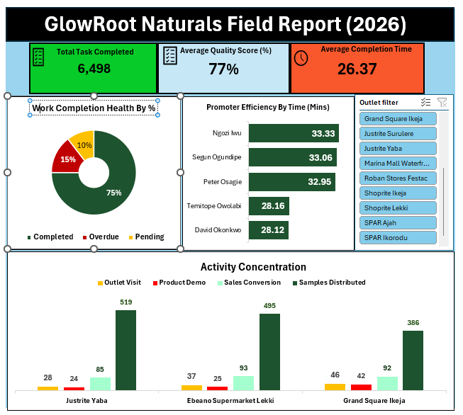

# EXCEL-PROJECT

## **GlowRoot Naturals Field Performance Report (2026)**

## **Executive Summary**

- The GlowRoot Naturals field performance dashboard reports **6,498, total tasks completed**, **average quality score of 77%** and an **average completion time of 26.37**. the work-completion chart shows **75% completed**, **15% overdue** and **10% pending**.
- The outlet activity comparison highlights different strengths across the three outlets displayed.
- **Grand Square Ikeja** records the highest number of outlet visits (46) and product demonstrations (42), **Ebeano Supermarket Lekki** records the highest sales conversions (93), and **Justrite Yaba** records the highest number of samples distributed
(519).
The promoter chart shows displayed time values ranging from **28.12 to
33.33 minutes** for the five promoters shown. These results provide a
snapshot of field activity, work status and promoter performance. The
dashboard can help managers identify where follow-up, operational review
and further investigation may be useful.

## **Business Context**

- GlowRoot Naturals' dashboard brings together field-task completion,
quality, completion time, promoter performance and outlet activity. It
presents these measures in one Excel report, with an outlet filter that
allows the viewer to focus on selected locations.

## **Objectives**

- What are the headline field performance indicators shown in the
    dashboard?
- What proportion of work is completed, overdue and pending?
- How do the displayed promoter time values compare?
- How do outlet visits, product demonstrations, sales conversions and
- samples distributed compare across the displayed outlets?
- How can the dashboard's outlet filter support more focused
    performance monitoring?

## **Data Overview**

The dashboard displays operational performance information for GlowRoot
Naturals in 2026.

The visible report includes:
- Total tasks completed
- Average quality score
- Average completion time
- Work-completion status
- Promoter efficiency by time
- Outlet activity across selected field activities
- An interactive outlet filter.

## **Key Findings**

- **6,498** total tasks are reported as completed.
- The average quality score is **77%**.
- Average completion time is displayed as **26.37**. 
- Work completion health is **75% completed**, **15% overdue** and
    **10% pending**.
- Among the five promoters shown, **Ngozi Iwu** has the highest
    displayed time value at **33.33 minutes**, while **David Okonkwo**
    has the lowest at **28.12 minutes**.
-   **Grand Square Ikeja** records the highest displayed outlet
    visits (46) and product demonstrations (42).
-   **Ebeano Supermarket Lekki** records the highest displayed sales
    conversions (93).
-   **Justrite Yaba** records the highest displayed samples distributed
    (519).
    

## DASHBOARD 

 

## **Data Cleaning and Transformation**

- Cleaned Data worksheet
- Checked for duplicate records.
- Corrected data types.
- Standardized text values.
- Handled missing values.
- Created calculated columns and  measures.
- Prepared summary tables for the dashboard.

### **Headline Performance**

The dashboard reports 
- **6,498 total tasks completed**,
-  a **77% average quality score** and
- an **average completion time of 26.37**.

These three KPIs provide a high-level view of field activity: 
- Total tasks completed communicates the reported volume of completed work.

- Average quality score summarizes the quality measure used in the
workbook.
- Average completion time provides a time-based performance indicator.

### **Work Completion Health**

The doughnut chart shows the following distribution:

  Work status     Share
  ------------- -------
  Completed         75%
  Overdue           15%
  Pending           10%

The chart indicates that three-quarters of the work represented in this
visual is completed. The remaining 25% is split between overdue and
pending work.

The overdue and pending portions identify work that may require review
and follow-up. The screenshot does not show the underlying task counts
for these percentages, so counts should not be calculated from the 6,498
KPI without confirming that both visuals use the same population.

### **Promoter Efficiency by Time**

The chart titled **Promoter Efficiency By Time (Mins)** displays these
values:

  Promoter             Displayed time (mins)
  ------------------ -----------------------
  Ngozi Iwu                            33.33
  Segun Ogundipe                       33.06
  Peter Osagie                         32.95
  Temitope Owolabi                     28.16
  David Okonkwo                        28.12

- **Ngozi Iwu** has the highest displayed value among the five promoters
shown, followed closely by
- **Segun Ogundipe** and Peter Osagie. David
**Okonkwo** has the lowest displayed value in this group.

**Outlet-level observations:**

- **Justrite Yaba** has the highest displayed number of samples
    distributed (519).
- **Ebeano Supermarket Lekki** has the highest displayed sales
    conversions (93).
- **Grand Square Ikeja** has the highest displayed outlet visits (46)
    and product demonstrations (42).
- Grand Square Ikeja records 92 sales conversions, one fewer than
    Ebeano Supermarket Lekki.
- Samples distributed are highest at Justrite Yaba and lowest at Grand
    Square Ikeja among the three outlets shown.

### **Outlet Filtering**

The dashboard includes an **Outlet filter** slicer with outlet options.
This interactive feature allows users to select an outlet and explore
the dashboard at a more focused level.

## **Recommendations**

- **Follow up on overdue and pending work:** Review the tasks
    represented by the 15% overdue and 10% pending portions, identify
    recurring causes and assign clear follow-up actions.
- **Investigate the quality score:** Review the records behind the 77%
    average quality score to identify common quality gaps and
    opportunities for improvement.
- **Clarify time-based measures:** Confirm the calculation and unit for average completion time and promoter time. Use a clearly defined target or benchmark before judging performance.
-  **Review outlet activity:** Compare the activity mix across Justrite Yaba, Ebeano Supermarket Lekki and Grand Square Ikeja to understand why their visits, demonstrations, conversions and sample distribution differ.
- **Investigate conversion performance:** Examine the activities and onditions associated with Ebeano Supermarket Lekki's 93 displayed sales conversions.
- **Use the outlet filter in operational reviews:** Filter the dashboard by outlet during regular reviews to identify location-specific patterns and follow-up needs.

## **Tools Used**

- **Microsoft Excel:** dashboard development and reporting
- **Excel charts:** doughnut, horizontal bar and clustered column
    visualizations
- **Excel slicer:** outlet filtering, - PivotTables
- Formulas
- Power Query. 

## **Conclusion**

The GlowRoot Naturals Field Performance Dashboard provides a
consolidated view of task completion, work quality, completion time,
promoter time values and outlet activity. It highlights a 75% completed
share in the work-health chart, differences in promoter time values and
distinct activity patterns across the three outlets displayed.

The project demonstrates how Microsoft Excel can be used to organize
operational metrics into a visual report that supports performance
monitoring and comparison.

